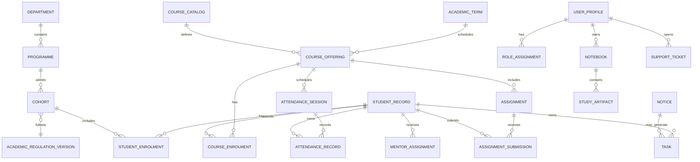

# Data Model and Conceptual ERD

**Status:** Proposed logical model, not an executable migration  
**Date:** 2026-10-10

## 1. Modeling rules

1. Separate **institutional academic records**, **personal planning**, and **AI learning artifacts**.
2. Never treat an AI-generated course/plan/mark as an official academic record.
3. Academic facts should link to a source, last-observed time, and (where policy-driven) the regulation version that applies.
4. Use immutable identifiers (UUIDs internally); store public-facing college/university roll identifiers separately and do not expose them unnecessarily.
5. Use normalized relational data for core facts. JSON is acceptable for validated flexible UI/artifact payloads, not as a substitute for relationships and constraints.
6. Use UTC timestamps in storage and render in the configured campus timezone (`Asia/Kolkata` initially, subject to owner approval).
7. Add retention/deletion rules for user uploads, chat logs, ticket data, and audit records before production.

## 2. Proposed domain areas

### Identity and authorization
- `profiles`: user display/profile information linked to auth identity.
- `role_assignments`: role plus scope (institution, department, course offering, assigned mentee) and validity period; avoid trusting a free-form profile `role` field for authorization.
- `student_records`: protected student profile mapping.
- `staff_records`: protected staff profile mapping.
- `departments`, `programmes`, `cohorts`/`admission_batches`, `academic_regulation_versions`.
- `student_enrolments`: student-to-programme/cohort/current status; historical enrolments retained as needed.

### Academic structure and rules
- `academic_terms`: term/semester dates and status.
- `course_catalog`: reusable subject/course definitions.
- `course_offerings`: an actual subject delivered to a cohort/term by assigned faculty; distinct from self-study courses.
- `course_enrolments`: student-to-offering relationship.
- `policy_documents`: approved source, version, effective date, applicability, verification and reviewer.
- `policy_rules`: structured, typed rules only after human validation; store rule type, expression/parameters, policy document, validity interval and applicability.

### Schedule, work, assessments
- `timetable_events`: class/lab/exam/event occurrence, source, course offering, start/end/location, status and last-updated timestamp.
- `attendance_sessions`: the class/practical session and its source.
- `attendance_records`: student, session, recorded status, record source, correction/version metadata and last-observed timestamp.
- `assignments`: creator, course offering, instructions, due date, submission channel and status.
- `assignment_submissions`: student, assignment, file/URL, submitted time, receipt/reference, evaluation status.
- `assessment_components`: type/name/max score/weighting with applicable rules/version.
- `assessment_results`: student, component, score/status, source and audit metadata.
- `exam_events`: published examination date/session and notice reference.
- `result_records`: authoritative result values and publication provenance; never inferred by the model.

### Notices, tasks and notifications
- `notices`: title, original text/file/link, source, published/issued/imported dates, applicability, verification state and reviewer.
- `tasks`: task owner, type (`personal`, `teacher`, `official_notice`, `ai_suggested`), deadline, status, source link, confirmation state.
- `reminder_preferences` and `notification_events`: channel preference, scheduling/delivery state, minimal payload and failure metadata.

### Mentorship and help desk
- `mentor_assignments`: student, mentor, scope, effective dates, assigning authority and status.
- `mentor_followups`: appointment/action metadata; sensitive notes must be separated/restricted if they exist at all.
- `support_tickets`: requester, category, description, status, assignee, allowed viewers and timestamps.
- `ticket_events`: status/assignment/action history with minimized sensitive data.

### Learning and GenUI
- `learning_documents`: owner, title, object storage key, mime type, processing state, retention state.
- `document_chunks`: document, chunk index, extracted text, embedding/model metadata; access inherited from and checked against the parent document.
- `notebooks`, `notebook_items`, `study_artifacts`: notes and safe artifacts such as quizzes, flashcards, study plans. Store schema version and `created_by`/source references; never store executable UI code.
- `ai_conversations`, `ai_messages`: owner, timestamps, safe message data and tool/result references according to retention rules.
- `ai_action_proposals`: proposed structured action, expiry, state, confirmation identity/time; optional and only for actions that need confirmation.

### Operations and audit
- `audit_events`: actor, action, resource type/id, result, timestamp, correlation/request ID, safe metadata; never dump secrets or sensitive free-text by default.
- `source_sync_runs`: import/check timestamp, result, source fingerprint and error category where automated feeds exist.

These names are conceptual. Final table design follows approved feature scope and must not be implemented all at once without concrete workflows.

## 3. Relationship sketch

## 4. Data integrity constraints

- Unique identifiers for external source records where available; otherwise deduplicate notices using normalized source URL plus fingerprint and review.
- Scores must have valid bounds and a clear maximum/component; changes require authorized source and audit.
- Attendance percentages are computed from valid, non-duplicated session records and shown with numerator/denominator; zero denominator is “not available,” not 0%.
- All timestamps use a consistent storage policy; due-date semantics distinguish date-only deadlines from precise instants.
- A student's academic regulation must be resolved from effective-dated cohort/programme/term data, never from client input alone.
- Foreign key and unique constraints protect assignment ownership and duplicate submission/attendance rows where the business rule requires it.
- Status values are constrained enums or lookup tables; transitions are validated server-side.

## 5. RLS and authorization design

RLS should be enabled for tables containing private or institution-scoped records. Policies must enforce ownership and explicit staff assignment/scope. Service-role keys must only be used in trusted server-side jobs; never use service-role access to bypass permission checks for end-user actions.

Tests must include cross-user attempts, guessed IDs, role escalation, stale mentor assignment, department boundary, and direct API invocation without a UI.

## 6. Storage

- Use private object storage buckets for student files and sensitive attachments.
- Store object keys and metadata, not unrestricted public URLs, for private content.
- Issue short-lived signed URLs only after server-side authorization.
- Validate file type/size, scan/process safely, and apply retention/deletion policies.

## 7. Migration strategy

- Create additive, reviewed migrations with constraints and rollback/recovery notes.
- Test migrations on a disposable local database seeded with synthetic data.
- Avoid dropping/recreating tables to “reset” development.
- Keep a schema diagram generated/updated from reviewed migrations, not treated as the authoritative schema by itself.

## 8. Open questions before schema implementation

- Which identity source will map login accounts to official roll/programme/cohort records?
- Can official attendance/marks/routine data be obtained through an authorized API or export?
- Which exact staff role and source owns corrections to each academic record?
- What retention periods are approved for learning documents, chat history, support tickets, and mentor follow-ups?
- Is multi-institution/multi-campus tenancy actually needed, or should the initial model be single-institution with scope fields kept simple?
